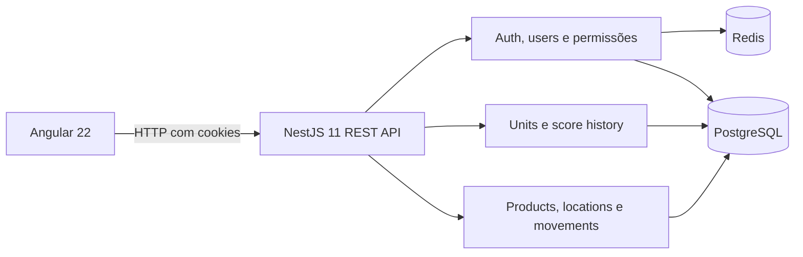

<div style="text-align:center">
  
  <h1>SIGADBV</h1>
</div>

**Full-stack TypeScript · Angular · NestJS**

**SIGADBV — Sistema de Gestão Automatizada de Desbravadores** é uma aplicação web e API para apoiar a gestão de clubes de Desbravadores. Digitaliza fluxos de unidades e pontuação e oferece operações de estoque pela API.

O foco técnico do projeto está na separação entre interface e API, autorização por permissões, integração com PostgreSQL e Redis e consistência em operações concorrentes de aprovação de pontuação.

## O que o sistema oferece

- **Visão geral:** ranking de unidades e moderação de solicitações de pontuação pendentes.
- **Unidades e histórico:** consulta de unidades, pontuação, solicitante e decisão; relatório preparado para impressão ou salvamento em PDF pelo navegador.
- **Fluxo de pontuação:** solicitações ficam pendentes até aprovação ou rejeição. A aprovação atualiza o saldo dentro de uma transação PostgreSQL; bloqueio pessimista e atualização condicional protegem contra decisões concorrentes ou duplicadas.
- **Autenticação:** login, troca obrigatória de senha no primeiro acesso, renovação de sessão e logout usando cookies `HttpOnly` e blacklist de refresh tokens no Redis.
- **Acesso por permissões:** guards da API validam a sessão e as permissões associadas aos papéis do usuário.
- **API de estoque:** endpoints para produtos, categorias, localizações e movimentações de entrada, saída e transferência.

> A interface web atual concentra-se em autenticação, troca de senha, visão geral, unidades e pontuação. Produtos, categorias, localizações, movimentações, usuários e papéis estão disponíveis na API, sem telas correspondentes localizadas no frontend.

## Arquitetura



### Decisões técnicas em destaque

- O backend organiza os domínios em módulos NestJS com controllers, services, repositories, DTOs e entidades TypeORM.
- A aprovação de pontuação usa uma transação única, lock `pessimistic_write` e validação condicional do estado pendente para proteger o saldo e o histórico.
- A autenticação usa cookies seguros no navegador; o frontend não persiste tokens em `localStorage`.
- O frontend separa domínio, aplicação, infraestrutura, stores e features. Adapters HTTP implementam ports, stores usam Angular Signals e páginas são carregadas sob demanda pelo router.
- O PostgreSQL é a fonte persistente dos dados; o Redis guarda a blacklist de refresh tokens com expiração.

## Tecnologias

| Área | Tecnologias |
| --- | --- |
| Frontend | Angular 22, TypeScript, RxJS, Tailwind CSS, Chart.js |
| Backend | Node.js, NestJS 11, TypeScript, TypeORM |
| Dados e sessão | PostgreSQL, Redis |
| API e segurança | REST, Swagger/OpenAPI, Passport/JWT, validação de DTOs, Helmet |
| Testes | Jest e Supertest; Vitest e Playwright |
| Execução local e deploy | pnpm, Docker Compose ou serviços hospedados sem Docker |

## Executar localmente com Docker

O Compose de desenvolvimento executa frontend, API, PostgreSQL e Redis. Ele usa um volume PostgreSQL externo destinado ao banco local de testes.

```sh
docker volume create sigadbv-postgres
docker compose -f compose.dev.yaml up
```

Abra:

- Frontend: [http://localhost:4200](http://localhost:4200)
- Swagger da API: [http://localhost:3000/api](http://localhost:3000/api)
- OpenAPI JSON: [http://localhost:3000/api-json](http://localhost:3000/api-json)

Para criar o administrador inicial no ambiente local:

```sh
docker compose -f compose.dev.yaml exec backend pnpm seed:admin
```

Sem `ADMIN_PASSWORD`, o seed gera uma senha temporária e a exibe no terminal. O Compose de desenvolvimento ativa a sincronização TypeORM; use-o somente com o banco local de testes.

## Testes e builds

Os manifests de cada aplicação possuem scripts independentes. Execute-os na pasta correspondente.

```sh
# backend
cd backend
pnpm install --frozen-lockfile
pnpm test
pnpm test:e2e
pnpm build
```

```sh
# frontend
cd frontend
pnpm install --frozen-lockfile
pnpm test
pnpm test:e2e
pnpm build
```

Os testes E2E do backend sincronizam e limpam o banco configurado. Use somente um banco descartável para executá-los; não aponte essas suites para dados persistentes.

## Deploy

O deploy pode ser feito **com Docker ou sem Docker**:

- [Deploy sem Docker](docs/deploy-sem-docker.md): API em Node.js e frontend publicado como aplicação estática.
- [Deploy com Docker](docs/deploy-docker.md): API, frontend, PostgreSQL e Redis em containers Docker Compose.

`backend/.env.example` é o modelo único de variáveis. O Compose de produção pode usá-lo como base: copie para `backend/.env` e configure os valores para o ambiente. Em hospedagens gerenciadas, cadastre as mesmas variáveis no painel do serviço.

## Estrutura do repositório

```text
backend/   API NestJS, migrations, seeds e testes
frontend/  Aplicação Angular e testes
docs/      Arquitetura, regras de negócio e guias de deploy
compose.dev.yaml
compose.prod.yaml
```

Para aprofundar-se nos componentes, consulte o [README do backend](backend/README.md) e o [README do frontend](frontend/README.md).
Para detalhes dos fluxos funcionais e decisões estruturais, consulte [funcionalidades](docs/funcionalidades.md) e [arquitetura](docs/arquitetura.md).
