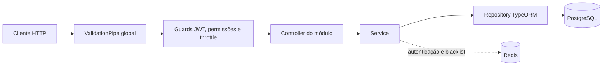

# SIGADBV Backend

API REST do SIGADBV, um ERP para clubes de desbravadores da Igreja Adventista do Sétimo Dia. O projeto busca facilitar a administração do clube e reduzir processos antes realizados verbalmente ou em papel. A primeira versão está em produção, conforme informado pelo responsável.

O backend atende operações de autenticação, usuários e permissões, unidades e pontuação, além de cadastros e movimentações de estoque. As telas disponíveis estão concentradas em autenticação, unidades e pontuação no [frontend](../frontend/README.md); produtos, categorias, localizações e movimentações estão disponíveis na API, sem telas correspondentes identificadas no frontend.

## Sumário

- [Tecnologias](#tecnologias)
- [Arquitetura](#arquitetura)
- [Módulos da API](#módulos-da-api)
- [Segurança](#segurança)
- [Persistência](#persistência)
- [Testes](#testes)
- [Instalação e execução](#instalação-e-execução)
- [API](#api)
- [Estrutura](#estrutura)
- [Considerações técnicas](#considerações-técnicas)

## Tecnologias

As versões abaixo são as faixas declaradas em `package.json`; o repositório não fixa uma versão de Node.js.

| Categoria               | Tecnologia                                        | Responsabilidade                                 |
| ----------------------- | ------------------------------------------------- | ------------------------------------------------ |
| Runtime e linguagem     | Node.js e TypeScript (`^5.7.3`)                   | Execução da API e tipagem estática               |
| Framework               | NestJS (`^11`)                                    | Módulos, controllers, providers e ciclo HTTP     |
| Banco de dados          | PostgreSQL (`pg ^8.21`)                           | Persistência relacional                          |
| ORM                     | TypeORM (`^1.0`)                                  | Entidades, repositories, consultas e transações  |
| Cache e sessão revogada | Redis (`redis ^6.1`)                              | Blacklist de refresh tokens e chaves temporárias |
| Autenticação            | Passport, `passport-jwt`, `@nestjs/jwt`, `bcrypt` | Estratégias JWT em cookies e hash de senhas      |
| Validação               | `class-validator`, `class-transformer`            | Validação e transformação de DTOs                |
| Documentação HTTP       | `@nestjs/swagger`                                 | Especificação OpenAPI e Swagger UI               |
| Testes                  | Jest, ts-jest e Supertest                         | Testes unitários e HTTP E2E                      |
| Segurança HTTP          | Helmet e CORS do Nest/Express                     | Cabeçalhos HTTP e política de origens            |

O gerenciador usado pelos scripts e lockfile é pnpm. O `package.json` do backend não declara uma versão específica do pnpm.

## Arquitetura

O backend é organizado em módulos NestJS por domínio. Nos módulos de negócio, controllers recebem requisições HTTP, services coordenam operações e regras, e repositories concentram o acesso TypeORM. DTOs definem os contratos de entrada; entidades representam os registros persistidos. Interfaces de serviço/repositório e tokens usados em `@Inject()` permitem registrar implementações no módulo.



Exemplo de fluxo: `MovementsController` delega ao `MovementsService`; este coordena `ProductsService`, `LocationsService` e `MovementsRepository`. Para entradas/saídas e alocações, o service abre uma transação TypeORM e passa o `EntityManager` às operações relacionadas.

## Módulos da API

| Módulo          | Responsabilidade                                           |
| --------------- | ---------------------------------------------------------- |
| `auth`          | Login, refresh e logout; emissão e revogação de tokens     |
| `users`         | Cadastro, consulta, papéis, senha e remoção de usuários    |
| `roles`         | Papéis, permissões e metadados de permissões               |
| `units`         | Cadastro e consulta de unidades e atualização de pontuação |
| `score-history` | Solicitações de ajuste, histórico, aprovação e rejeição    |
| `products`      | Cadastro, consulta e saldo geral de produtos               |
| `categories`    | Cadastro e consulta de categorias                          |
| `locations`     | Posições físicas e quantidades de produto por posição      |
| `movements`     | Entradas, saídas, alocações e histórico de estoque         |

Esses módulos estão registrados em `src/app.module.ts`. Ter um endpoint na API não implica que exista tela correspondente no frontend.

## Segurança

- Um `JwtAuthGuard` global protege rotas, com exceções marcadas por `@Public()`.
- A estratégia JWT lê `access_token` de cookie; refresh usa `refresh_token` e valida fingerprint de dispositivo.
- Cookies são configurados como `HttpOnly` e `SameSite=Strict`; em produção também são `Secure`. O refresh token usa o caminho `/auth`.
- Refresh tokens usados/revogados são registrados no Redis com expiração.
- `PermissionGuard` compara a permissão requerida pelo endpoint com as permissões no payload JWT. `@RequiresPermission()` é aplicado por operação.
- `ThrottlerGuard` é global e configurado para 10 requisições por janela de 60 segundos.
- `ValidationPipe` global transforma DTOs, remove campos não declarados e rejeita propriedades extras (`whitelist` e `forbidNonWhitelisted`).
- Helmet configura cabeçalhos de segurança; CORS aceita origens configuradas e credenciais.

`PATCH /users` altera a senha da conta autenticada e rejeita campos extras como `username`. Para emitir uma nova senha temporária para outra conta, use `POST /users/:username/temporary-password`, protegido pela permissão `USERS_UPDATE`; o próximo acesso exige a definição de uma senha definitiva. Consulte `../docs/regras-de-negocio.md`.

## Persistência

O TypeORM conecta-se ao PostgreSQL pela variável `DATABASE_URL` e carrega entidades dos módulos. Em `NODE_ENV=development`, `AppModule` habilita `synchronize` e logging de queries/erros; fora desse modo, sincronização fica desabilitada. O `DataSource` usado pelos scripts de migração também define `synchronize: false`.

Os relacionamentos principais incluem usuário–papel (muitos-para-muitos), produto–categoria, produto–localização por `ProductLocation`, movimentação–produto/localização e unidade–histórico de pontuação. Há scripts de migração e seeds em `src/database/` e `src/migration/`.

O repositório contém uma migração, que altera a tabela `score_history`; ela não cria sozinha todo o schema da aplicação. Para uma instalação nova, o processo completo de provisionamento do schema não está documentado pelo repositório. Não execute migrações em um banco sem verificar previamente o estado esperado.

## Testes

Jest executa testes unitários em `src/**/*.spec.ts`. Há suites de controllers, services e repositories dos módulos, além de estratégias, filtros e interceptors. Supertest é usado nos E2E em `tests/`, com cenários de autenticação, unidades, histórico de pontuação e limite de requisições.

```bash
pnpm test
pnpm test:e2e
pnpm test:cov
```

Os E2E de score-history incluem cenários para aprovação/rejeição, rollback diante de falhas de atualização e aprovações concorrentes contra PostgreSQL. Em 2026-11-06, `pnpm test:e2e` passou com 4 suites e 30 testes, incluindo 10 cenários de score-history. Os testes E2E inicializam o schema com `synchronize(true)` no helper `tests/setup-test-database.helper.ts`; isso pode remover tabelas existentes. Execute-os somente com um banco de teste descartável e Redis acessível. A execução não representa uma métrica de cobertura.

## Instalação e execução

### Pré-requisitos

- Node.js compatível com as dependências; o projeto não declara `engines` no `package.json`.
- pnpm instalado.
- PostgreSQL e Redis acessíveis pela máquina.
- Endereço remoto do repositório para o clone. O workspace não documenta uma URL de clone canônica.

### Preparação

```bash
git clone "<URL-do-repositório>"
cd "<diretório-do-repositório>/backend"
pnpm install
cp -n .env.example .env
```

Configure `backend/.env` localmente. Não versione esse arquivo nem compartilhe segredos.

| Variável                           | Uso e valor padrão observado                                                                                                                  |
| ---------------------------------- | --------------------------------------------------------------------------------------------------------------------------------------------- |
| `DATABASE_URL`                     | URL PostgreSQL; necessária para TypeORM                                                                                                       |
| `REDIS_URL`                        | URL Redis; o serviço usa `redis://localhost:6379` quando não definida. O `.env.example` contém valor vazio; preencha-o para a execução local. |
| `JWT_SECRET`, `JWT_REFRESH_SECRET` | Segredos usados para assinar/verificar tokens; configure valores próprios e não compartilhe                                                   |
| `ACCESS_TOKEN_EXPIRES_IN`          | Duração do access token; padrão de código `15m`                                                                                               |
| `REFRESH_TOKEN_EXPIRES_IN`         | Duração do refresh token; padrão de código `7d`                                                                                               |
| `NODE_ENV`                         | Defina `development` para ativar sincronização do TypeORM no `AppModule`                                                                      |
| `PORT`                             | Porta HTTP; padrão `3000`                                                                                                                     |
| `ALLOWED_ORIGINS`                  | Origens CORS separadas por vírgula; sem a variável, o código permite `http://localhost:4200`                                                  |
| `FRONTEND_URL`                     | Usada na mensagem de erro de tenant                                                                                                           |
| `ADMIN_USERNAME`, `ADMIN_PASSWORD` | O seed de administrador usa esses valores; sem senha, gera senha temporária e a imprime no terminal                                           |

O `.env.example` lista origens CORS de exemplo que não incluem `http://localhost:4200`. Se usar esse arquivo sem ajustes, inclua a origem do frontend local em `ALLOWED_ORIGINS`. O código atual usa `REDIS_URL`; `REDIS_PASSWORD` presente no exemplo não é lida diretamente pelo serviço.

### Schema e seeds

No modo de desenvolvimento, `AppModule` sincroniza entidades ao iniciar. Em outro modo, o TypeORM não sincroniza automaticamente. Os scripts disponíveis são:

```bash
pnpm migration:run
pnpm seed:permissions
pnpm seed:admin
pnpm seed:units
```

O comando de migração aplica as migrações existentes, mas elas não constituem um bootstrap completo de banco vazio. Os seeds conectam-se ao banco configurado; o de administrador pode gerar e imprimir uma senha temporária caso `ADMIN_PASSWORD` esteja vazia. Trate essa saída como credencial.

### Inicialização

```bash
pnpm run start:dev
```

A API escuta em `http://localhost:3000` por padrão. Para compilar e executar a versão compilada:

```bash
pnpm run build
pnpm run start:prod
```

## API

Com o servidor ativo, a interface Swagger fica em `http://localhost:3000/api` e o documento OpenAPI em `http://localhost:3000/api-json`.

Rotas representativas:

| Método e rota                     | Descrição                                   | Acesso                                             |
| --------------------------------- | ------------------------------------------- | -------------------------------------------------- |
| `POST /auth`                      | Login; requer `x-tenant-slug` e credenciais | Público                                            |
| `POST /auth/refresh`              | Renova cookies de sessão                    | Refresh cookie válido e fingerprint correspondente |
| `POST /auth/logout`               | Revoga refresh token e limpa cookies        | Refresh cookie válido                              |
| `GET /units`                      | Lista unidades                              | Cookie de acesso e `unit.read`                     |
| `POST /score-history/:unitId`     | Registra solicitação de ajuste              | Cookie de acesso e `score-history.adjust`          |
| `POST /score-history/:id/approve` | Aprova solicitação e aplica saldo           | Cookie de acesso e `score-history.approve`         |
| `POST /movements`                 | Registra entrada/saída de estoque           | Cookie de acesso e `movement.register`             |

Exemplo de login compatível com `LoginDto`:

```bash
curl -i -c /tmp/sigadbv-cookies.txt \
  -X POST http://localhost:3000/auth \
  -H 'Content-Type: application/json' \
  -H 'x-tenant-slug: sigadbv' \
  -d '{"username":"<usuario>","password":"<senha>"}'
```

Exemplo de solicitação de pontuação compatível com `ScoreHistoryDto`:

```bash
curl -i -b /tmp/sigadbv-cookies.txt \
  -X POST "http://localhost:3000/score-history/<unit-uuid>" \
  -H 'Content-Type: application/json' \
  -d '{"score":-15,"description":"Ajuste registrado"}'
```

O cookie de acesso é emitido pelo login. O tenant é fixo nesta versão: embora o login receba `x-tenant-slug`, o serviço mapeia o slug para o UUID zero; multi-tenancy não está implementado.

## Estrutura

```text
backend/
├── src/
│   ├── common/       # Guards, decorators, DTOs compartilhados, Redis e utilitários
│   ├── database/     # DataSource e seeds
│   ├── migration/    # Migrações TypeORM existentes
│   └── modules/      # Módulos NestJS por domínio
├── tests/            # Configuração E2E e suites HTTP
├── .env.example      # Modelo de configuração local
└── package.json      # Scripts e dependências
```

## Considerações técnicas

- O backend oferece recursos de estoque na API, sem interface de estoque localizada no frontend atual.
- Multi-tenancy foi adiado; a aplicação usa tenant fixo.
- A aprovação de pontuação usa uma transação TypeORM compartilhada entre o bloqueio/leitura da solicitação, o incremento/decremento do saldo e a atualização do status. O bloqueio `pessimistic_write`, a validação de estado e a atualização condicional previnem processamento duplicado; erros causam rollback das duas alterações.
- O comportamento de exclusões relacionais depende das constraints presentes no banco; o metadata ORM não comprova sozinho o schema de produção.
- `PATCH /users` altera apenas a conta identificada pelo JWT; o reset de senha temporária para outra conta exige `USERS_UPDATE`.
- `pnpm run lint` executa ESLint com `--fix`; pode modificar arquivos. Use-o sabendo desse efeito.

Para o contexto de negócio e as regras detalhadas, consulte [`../docs/visao.md`](../docs/visao.md), [`../docs/funcionalidades.md`](../docs/funcionalidades.md) e [`../docs/regras-de-negocio.md`](../docs/regras-de-negocio.md).
