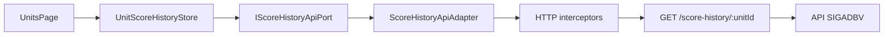

# SIGADBV Frontend

Aplicação web Angular do SIGADBV, ERP para clubes de desbravadores da Igreja Adventista do Sétimo Dia. A interface atende autenticação, visão geral e rotinas de unidades e pontuação, consumindo a [API backend](../backend/README.md). O público atual inclui líderes e usuários administrativos do clube; outras jornadas ainda estão em planejamento.

## Sumário

- [SIGADBV Frontend](#sigadbv-frontend)
  - [Sumário](#sumário)
  - [Tecnologias](#tecnologias)
  - [Arquitetura](#arquitetura)
  - [Funcionalidades](#funcionalidades)
  - [Estado e comunicação](#estado-e-comunicação)
  - [Testes](#testes)
  - [PWA](#pwa)
  - [Instalação e execução](#instalação-e-execução)
    - [Pré-requisitos](#pré-requisitos)
    - [Preparação](#preparação)
    - [Desenvolvimento e build](#desenvolvimento-e-build)
  - [Estrutura](#estrutura)

## Tecnologias

As versões indicadas correspondem às faixas declaradas em `package.json`.

| Tecnologia                                  | Responsabilidade                                        |
| ------------------------------------------- | ------------------------------------------------------- |
| Angular (`^22.1`) e Angular CLI (`^22.1.7`) | Componentes standalone, roteamento, formulários e build |
| TypeScript (`~6.0.2`)                       | Linguagem da aplicação                                  |
| RxJS (`~7.8`)                               | Fluxos HTTP e composição de operações assíncronas       |
| Tailwind CSS (`^4.1`)                       | Estilização da interface                                |
| Chart.js (`^4.5`) e `ng2-charts` (`^11`)    | Gráfico de pontuação no overview                        |
| `@lucide/angular`                           | Ícones                                                  |
| Vitest (`^4.0`) e `happy-dom`               | Testes unitários de componentes e lógica Angular        |
| Playwright (`^1.63`)                        | Testes E2E em Chromium                                  |
| Angular Service Worker                      | Cache de assets na configuração de produção             |

O projeto declara `pnpm@12.4.1` em `package.json`.

## Arquitetura

As páginas em `feature/` são componentes standalone carregados sob demanda pelo router. A composição em `app.config.ts` conecta tokens de injeção a stores, ports e adapters. A separação observada organiza modelos e regras por domínio/aplicação, implementações HTTP e do browser em infraestrutura e elementos reutilizáveis em `shared/`.

Fluxo real de consulta do histórico de pontuação:



| Camada             | Responsabilidade                                                                     |
| ------------------ | ------------------------------------------------------------------------------------ |
| `core/domain`      | Entidades e enums usados pela interface                                              |
| `core/application` | Modelos de entrada/saída, ports de APIs/stores e erros                               |
| `core/infra`       | Adapters HTTP/browser, guards, interceptors e tokens de DI                           |
| `core/store`       | Estado reativo e operações de tela para autenticação, usuários, unidades e pontuação |
| `feature`          | Páginas de login, troca de senha, overview e unidades                                |
| `shared`           | Componentes reutilizáveis, modal, tabela, gráficos e template de relatório           |

Os ports são contratos; adapters os implementam usando `HttpClient` ou APIs do browser. Páginas usam stores, que acessam adapters por tokens/ports.

## Funcionalidades

| Área           | Disponibilidade na interface                                                                                                 |
| -------------- | ---------------------------------------------------------------------------------------------------------------------------- |
| Autenticação   | Login, recuperação da sessão por refresh e logout                                                                            |
| Troca de senha | Definição da senha permanente no primeiro acesso                                                                             |
| Visão geral    | Ranking visual de unidades e lista para aprovar/rejeitar solicitações pendentes                                              |
| Unidades       | Consulta de unidades, gênero, capacidade máxima e pontuação                                                                  |
| Pontuação      | Registro de solicitação de ajuste com valor positivo ou negativo; aprovação e rejeição no overview                           |
| Histórico      | Consulta por unidade e exibição de solicitante, aprovador, motivo e data                                                     |
| Relatório      | Gera HTML formatado, abre nova janela e aciona a impressão do navegador; o usuário pode escolher imprimir ou salvar como PDF |

O frontend não possui telas identificadas para cadastro de produtos/categorias/localizações, movimentações de estoque, administração de usuários/papéis ou CRUD de unidades. Esses recursos estão disponíveis parcial ou totalmente na API, conforme descrito no [README do backend](../backend/README.md). Gestão de membros, turmas e relatórios de reunião de unidade são evoluções futuras, não funcionalidades atuais.

## Estado e comunicação

Stores usam Angular Signals para loading, erros, sessão, listas e seleções; valores derivados são expostos por signals somente leitura e `computed`. Adapters convertem Observables de `HttpClient` em Promises com `firstValueFrom`.

Os interceptors globais são registrados na ordem `apiErrorInterceptor`, `tenantInterceptor` e `authInterceptor`:

- **Erros:** `apiErrorInterceptor` converte erros HTTP em `ApiError`, preservando status e mensagem da API.
- **Tenant:** `tenantInterceptor` acrescenta `x-tenant-slug` às requisições cujo endereço contém `/auth`. O adapter atual fornece o slug fixo `sigadbv`.
- **Sessão:** chamadas de autenticação usam `withCredentials`. O backend define cookies `HttpOnly`; os tokens não são lidos nem persistidos pela aplicação JavaScript. O estado de sessão e usuário é mantido em Signals na memória.
- **Refresh:** quando uma requisição não relacionada à autenticação recebe 401, `authInterceptor` tenta renovar a sessão e repete a requisição. Se o refresh for recusado, chama logout local.

Não há configuração frontend por `.env`: `core/infra/tokens/url.token.ts` seleciona `http://localhost:3000` em desenvolvimento e `https://api.sigadbv.sgcode.com.br` fora do modo de desenvolvimento. Para uso local, a API deve estar acessível em `localhost:3000` e permitir CORS com credenciais para `http://localhost:4200`.

## Testes

Vitest é configurado para executar `src/**/*.spec.ts` em `happy-dom`; há testes de páginas, stores, adapters, guards, interceptors e componentes compartilhados. Playwright executa os testes de `e2e/` em Chromium. O `webServer` do Playwright inicia `pnpm start` na porta 4200; os cenários E2E de autenticação e troca de senha interceptam respostas da API.

```bash
pnpm test
pnpm test:e2e
```

Os comandos acima não implicam resultado de execução. Os testes não são descritos aqui como aprovados.

## PWA

O build de produção inclui a configuração `ngsw-config.json`, e `provideServiceWorker` registra o worker somente fora do modo de desenvolvimento. A configuração pré-carrega arquivos centrais da aplicação e carrega assets estáticos sob demanda, com prefetch em atualização. Não há grupo de cache de API configurado; portanto, esta configuração não comprova uso offline das funcionalidades ou dos dados.

## Instalação e execução

### Pré-requisitos

- Node.js compatível com Angular 22 e dependências do projeto; `package.json` não declara `engines`.
- pnpm `12.4.1`, conforme `packageManager`.
- API SIGADBV acessível em `http://localhost:3000` para executar a interface local com backend.

### Preparação

```bash
git clone "<URL-do-repositório>"
cd "<diretório-do-repositório>/frontend"
pnpm install
```

O repositório não contém `.env`/`.env.example` do frontend. A URL da API é definida em `src/app/core/infra/tokens/url.token.ts`; não há variável de ambiente documentada para substituí-la.

### Desenvolvimento e build

```bash
pnpm start
```

Abra `http://localhost:4200`. Para build de produção:

```bash
pnpm build
```

Outros comandos declarados:

```bash
pnpm lint
pnpm format:check
pnpm test
pnpm test:e2e
```

O build executa `ng build --configuration production`; o script `watch` usa build de desenvolvimento em modo watch.

## Estrutura

```text
frontend/
├── e2e/                   # Cenários Playwright
├── public/                # Manifest e assets públicos
├── src/app/core/
│   ├── application/       # Modelos, ports e tratamento de erros
│   ├── domain/            # Entidades e enums
│   ├── infra/             # Adapters, guards, interceptors e tokens
│   └── store/             # Estado Signals
├── src/app/feature/       # Páginas de autenticação, overview, unidades e senha
├── src/app/shared/        # Componentes, seções e template de relatório
├── ngsw-config.json       # Cache de assets do Service Worker
├── playwright.config.ts   # Configuração E2E
└── package.json           # Scripts e dependências
```

Consulte [`../docs/visao.md`](../docs/visao.md) e [`../docs/funcionalidades.md`](../docs/funcionalidades.md) para o contexto de negócio e o inventário de funcionalidades.
